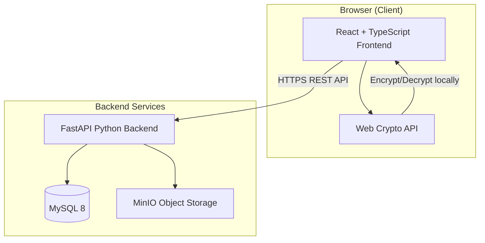
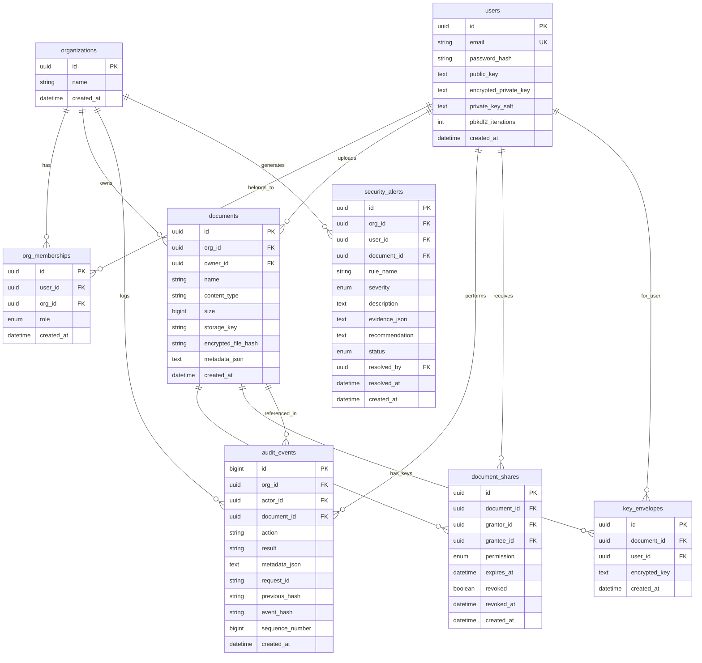

# TrustVault — Architecture Document

## System Overview

TrustVault is a secure document-sharing platform with client-side encryption, per-document access control, tamper-evident audit logging, an access-policy simulator, and rule-based security alerts.

## Architecture Diagram



## Technology Stack

| Layer | Technology |
|-------|-----------|
| Frontend | React 18, TypeScript (strict), Vite, Tailwind CSS, React Router, React Query |
| Backend | Python 3.12, FastAPI, Pydantic v2, SQLAlchemy 2, Alembic |
| Database | MySQL 8 with InnoDB |
| Object Storage | MinIO (S3-compatible) |
| Auth | Argon2id, HTTP-only secure cookies, CSRF tokens |
| Crypto | Web Crypto API (AES-256-GCM, RSA-OAEP, PBKDF2) |
| Testing | Pytest, Vitest, Playwright |
| DevOps | Docker, Docker Compose, GitHub Actions |

## Directory Structure

```
TrustVault/
├── backend/
│   ├── app/
│   │   ├── api/           # Route handlers
│   │   ├── core/          # Config, security, crypto
│   │   ├── models/        # SQLAlchemy models
│   │   ├── schemas/       # Pydantic schemas
│   │   ├── services/      # Business logic
│   │   ├── middleware/     # CSRF, rate limiting
│   │   └── main.py        # FastAPI app
│   ├── migrations/        # Alembic migrations
│   ├── tests/             # Pytest tests
│   ├── requirements.txt
│   └── Dockerfile
├── frontend/
│   ├── src/
│   │   ├── components/    # Reusable UI
│   │   ├── pages/         # Route pages
│   │   ├── services/      # API client
│   │   ├── crypto/        # Web Crypto utilities
│   │   ├── hooks/         # React hooks
│   │   ├── stores/        # State management
│   │   └── types/         # TypeScript types
│   ├── package.json
│   └── Dockerfile
├── docker-compose.yml
├── .env.example
├── .gitignore
└── README.md
```

## Database Schema



## Encryption Architecture

### Key Hierarchy
1. **User Vault Passphrase** → PBKDF2 → **Wrapping Key** → encrypts user's RSA private key
2. **RSA Key Pair** (per user) → RSA-OAEP wraps/unwraps document keys
3. **Document Key** (AES-256-GCM, per document) → encrypts file content

### Flows
- **Upload**: Generate AES key → encrypt file → wrap key with owner's RSA public key → upload ciphertext + wrapped key
- **Share**: Owner unwraps doc key → re-wraps with recipient's RSA public key → store new envelope
- **Access**: Fetch ciphertext + user's envelope → unwrap AES key → decrypt file locally

## Security Model

- Zero-knowledge: server never sees plaintext documents or vault passphrases
- Per-document ACL enforced server-side
- Organization isolation on every query
- Hash-chain audit trail with SHA-256
- Rate limiting on auth endpoints
- CSRF protection via double-submit cookie
- Argon2id password hashing
- HTTP-only secure session cookies

## Threat Model Limitations

1. Server admin with DB access can recompute hash chains
2. Revocation cannot retract already-decrypted content
3. Browser-side crypto depends on trusted code delivery
4. No HSM integration in initial version
